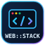
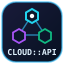
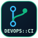

  

  
  &nbsp;&nbsp;&nbsp;&nbsp;
  

  

  
  
  
  

  

## ❖ About Me · Hakkımda

<table>
  <tr>
    <td width="50%" valign="top">

### 🧭 Engineering Profile (English)

Hi, I am Sardar (سەردار) — a software engineer focused on building clean, practical, and high-performance web applications, backend APIs, and modern developer tools. I value simple architecture, readable code, and software that solves real problems.

- **Modern Web & Full-Stack Engineering**: Building responsive, well-structured frontend interfaces and solid backend services with TypeScript, React, Next.js, and Python.
- **Cloud Backend & Scalable APIs**: Designing fast REST & GraphQL APIs, asynchronous data pipelines, and reliable PostgreSQL & Redis database architectures.
- **AI Workflows & Developer Automation**: Creating practical AI integrations, custom CLI & IDE extensions, and automated Docker + GitHub Actions deployment workflows.

    </td>
    <td width="50%" valign="top">

### 🧭 Mühendislik Profili (Türkçe)

Merhaba, ben Sardar (سەردار) — temiz, ölçeklenebilir ve yüksek performanslı web uygulamaları, arka uç (backend) servisleri ve modern geliştirici araçları üzerine çalışan bir yazılım mühendisiyim. Sade mimariye, okunabilir koda ve gerçek dünya problemlerini çözen ürünlere odaklanıyorum.

- **Modern Web & Full-Stack Geliştirme**: TypeScript, React, Next.js ve Python kullanarak hızlı, kullanıcı dostu arayüzler ve sağlam arka uç servisleri geliştiriyorum.
- **Bulut Mimarisi & Ölçeklenebilir API Tasarımı**: Yüksek trafikli REST servisleri, asenkron veri işleme hatları ve PostgreSQL / Redis tabanlı güvenilir veri katmanları kurguluyorum.
- **Yapay Zeka Entegrasyonu & Otomasyon**: Geliştirici verimliliğini artıran AI araçları, özel tarayıcı/IDE eklentileri ve Docker + CI/CD otomasyon süreçleri inşa ediyorum.

    </td>
  </tr>
</table>

  

## ❖ Core Engineering Focus · Temel Uzmanlık Alanları

<table>
  <tr>
    <td width="25%" align="center" valign="top">
       
      <strong>Full-Stack Web Platforms</strong> 
      Full-Stack Web Sistemleri  
      <code>TypeScript · React · Next.js · Tailwind</code>
    </td>
    <td width="25%" align="center" valign="top">
       
      <strong>Cloud & Backend APIs</strong> 
      Bulut & Backend Servisleri  
      <code>Python · FastAPI · Node.js · PostgreSQL</code>
    </td>
    <td width="25%" align="center" valign="top">
       
      <strong>AI & Smart Automation</strong> 
      Yapay Zeka & Otomasyon  
      <code>LLM APIs · Agent Workflows · Extensions</code>
    </td>
    <td width="25%" align="center" valign="top">
       
      <strong>DevOps & Product Quality</strong> 
      DevOps & Sistem Kalitesi  
      <code>Docker · GitHub Actions · CI/CD · Linux</code>
    </td>
  </tr>
</table>

  

## ❖ Tech Stack & Tooling · Teknoloji Yığını

  

  
  
  
  
  
   
  
  
  
  

  

## ❖ Featured Projects · Öne Çıkan Projeler

<table>
  <thead>
    <tr>
      <th width="8%" align="center">Icon</th>
      <th width="30%" align="left">Project · Proje</th>
      <th width="22%" align="left">Stack · Teknoloji</th>
      <th width="40%" align="left">Overview · Açıklama</th>
    </tr>
  </thead>
  <tbody>
    <tr>
      <td align="center"></td>
      <td>
        <strong>Nexus Cloud · Modern Full-Stack Workspace</strong> 
        Nexus Cloud · Ölçeklenebilir Web ve Veri Platformu
      </td>
      <td><code>TypeScript</code> · <code>Next.js</code> <code>Tailwind CSS</code> · <code>PostgreSQL</code></td>
      <td>
        A clean, real-time collaborative web platform featuring sub-100ms UI responsiveness, modular design tokens, and role-based access control. 
        Gerçek zamanlı veri senkronizasyonu, modüler tasarım sistemi ve güvenli yetkilendirme altyapısına sahip modern web platformu.
      </td>
    </tr>
    <tr>
      <td align="center"></td>
      <td>
        <strong>PulseCore · High-Speed Async API Engine</strong> 
        PulseCore · Yüksek Performanslı Asenkron API Motoru
      </td>
      <td><code>Python 3.12</code> · <code>FastAPI</code> <code>Redis</code> · <code>Docker</code></td>
      <td>
        Lightweight asynchronous backend service handling concurrent webhook ingestion, rate limiting, and background job queues with minimal memory overhead. 
        Yüksek eşzamanlı veri akışlarını, önbellekleme ve arka plan görev kuyruklarını düşük kaynak tüketimiyle yöneten asenkron servis.
      </td>
    </tr>
    <tr>
      <td align="center"></td>
      <td>
        <strong>DevPilot · AI Workflow & Extension Suite</strong> 
        DevPilot · Yapay Zeka Destekli Geliştirici Araçları
      </td>
      <td><code>TypeScript</code> · <code>VS Code API</code> <code>Chrome MV3</code> · <code>LLM SDK</code></td>
      <td>
        A cohesive set of developer extensions and structured AI prompts that automate code review summaries, documentation generation, and i18n checks. 
        Kod inceleme özetlerini, teknik dokümantasyon üretimini ve çok dilli çeviri kontrollerini otomatikleştiren geliştirici eklenti paketi.
      </td>
    </tr>
    <tr>
      <td align="center"></td>
      <td>
        <strong>ShipFlow · Automated CI/CD & Release Kit</strong> 
        ShipFlow · Otomatik CI/CD ve Dağıtım Altyapısı
      </td>
      <td><code>GitHub Actions</code> · <code>Docker</code> <code>Linux</code> · <code>OpenAPI</code></td>
      <td>
        Ready-to-use deployment blueprints providing automated linting, container security checks, and zero-downtime rollouts for modern engineering teams. 
        Otomatik kod kalitesi kontrolü, konteyner güvenlik taraması ve kesintisiz canlıya alma süreçleri sunan hazır DevOps şablonları.
      </td>
    </tr>
  </tbody>
</table>

  

## ❖ GitHub Analytics · İstatistikler

  
  

  

